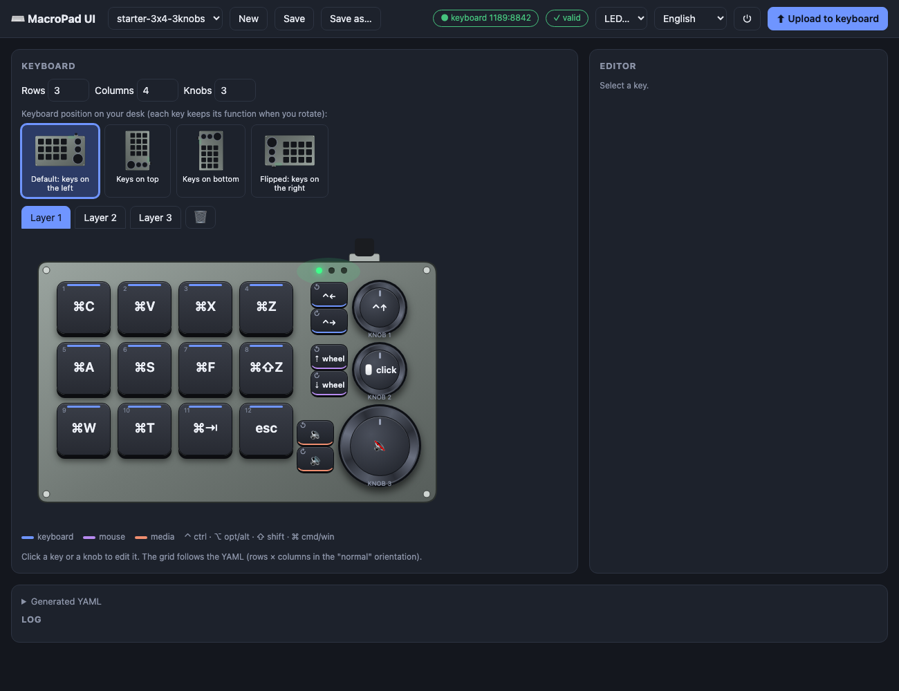

# MacroPad UI

A small, local web UI for programming **CH57x USB macro keyboards** (the cheap 3×4 pads with knobs sold on AliExpress/Amazon) — without the Windows-only vendor software.

It draws your keyboard, lets you click a key or knob and set what it does, and uploads the mapping to the device in one click. The USB work is done by the excellent [`ch57x-keyboard-tool`](https://github.com/fabianocastello/ch57x-keyboard-tool); MacroPad UI is just a friendly front end for it.



## Features

- Visual keyboard with keys, knobs (turn left / press / turn right) and 3 layers
- Four board orientations (keys left / top / bottom / right) — rotating keeps every physical key's function
- Key editor: modifier chords, key sequences, mouse actions, media keys, raw HID codes
- **"Type text"**: turn a string like `Hello, world!` into the key sequence a key will type
- **Capture**: press a combination on your computer's keyboard to fill it in
- Live validation, generated-YAML preview, save/load of your own configs
- **Reopens where you left off**: the last config you edited or uploaded (and the layer, even with unsaved changes) comes back on the next launch
- **Export / import a layer** to a file (⤓ / ⤒ beside the layer tabs) — share a layer, or move it between configs and orientations
- One-click upload (asks for your admin password once per upload on macOS)
- UI in **English** and **Português** (auto-detected, switch any time)
- Optional double-click **macOS app** with a Dock icon

## Requirements

- macOS (tested). Linux should work for the UI + tool; Windows is untested.
- Python 3.8+ and PyYAML: `pip3 install -r requirements.txt`
- [`ch57x-keyboard-tool`](https://github.com/fabianocastello/ch57x-keyboard-tool) — build it from that repository (`cargo install --git https://github.com/fabianocastello/ch57x-keyboard-tool`).
  MacroPad UI looks for it in `$MACROPAD_TOOL`, `./bin/`, your `PATH`, `~/.cargo/bin`, `/opt/homebrew/bin`, `/usr/local/bin` (or pass `--tool PATH`).
- A supported keyboard (USB IDs `1189:8840`, `1189:8842`, `1189:8890`), connected with a **USB cable** (also for Bluetooth models).

## Run

```sh
pip3 install -r requirements.txt
python3 macropad_ui/server.py          # opens http://127.0.0.1:8777
```

Options: `--port N`, `--no-open`, `--tool PATH`, `--configs DIR`.
Your configs live in `~/Library/Application Support/MacroPad UI/configs` (macOS) or `~/.config/macropad-ui/configs` (Linux); two examples are copied there on first run.

## macOS app (Dock icon)

```sh
scripts/make_app.sh --install     # builds ./build/MacroPad UI.app and copies it to /Applications
```

Without `--install` the app is just built into `./build/`; drag it to `/Applications` (or the Dock) yourself.
The app bundles the UI/server, remembers where Python and the tool are, and starts the local server when opened. Use the ⏻ button in the page to stop it.
Rebuild it if you move or reinstall Python or the tool.

## Using it

1. Pick a config, click a key or knob, set its function (raw value, text, chord builder, mouse, media).
2. Check the green **valid** badge, then **Upload to keyboard**.
3. On macOS the tool needs administrator rights to talk to the keyboard, so a native password dialog appears (it works no matter how you started the server: MacroPad UI opens a tiny helper app, `MacroPad Uploader.app`, in your graphical session).

Good to know:

- **Orientation**: *rows*/*columns* are counted with the keys on the left and knobs on the right. Changing the orientation in the picker rearranges the YAML for you so each physical key keeps its function. (`ch57x-keyboard-tool` reads a non-`normal` file already rotated — the app warns you when you open or upload one.)
- **Knob numbers** follow the order of the `knobs:` list in the YAML. The physical order differs between models, so test once and rearrange if needed.
- **Type text** uses US-QWERTY key positions, so it is also right for macOS "Brazilian – Pro". Accented characters and `ç` are not supported yet. A key can hold up to **18** key presses on the 8840/8842 chips and **5** on the 8890.
- Keys send *key codes*, not characters — with a non-QWERTY layout, think in QWERTY positions.
- The keyboard only stores key mappings; it can't launch apps. To launch something, bind an unusual chord (e.g. `ctrl-opt-shift-cmd-m`) and have macOS Shortcuts / BetterTouchTool react to it.

## Troubleshooting

| Message | Meaning |
| --- | --- |
| `Access denied (insufficient permissions)` | The tool needs admin rights. MacroPad UI then shows the macOS password dialog; enter your Mac password. |
| `The administrator user name or password was incorrect` | Wrong password in the macOS dialog (Touch ID isn't accepted there). Try again. |
| `keyboard not found` | Cable not connected, or a model with other USB IDs (see the tool's README). |

See [ROADMAP.md](ROADMAP.md) for what's planned.

## Credits & license

- [`ch57x-keyboard-tool`](https://github.com/fabianocastello/ch57x-keyboard-tool) (a fork of the original by kriomant, MIT / Apache-2.0) does all the keyboard communication.
- MacroPad UI is released under the [MIT license](LICENSE).
- Not affiliated with any keyboard manufacturer. You flash key mappings at your own risk.
